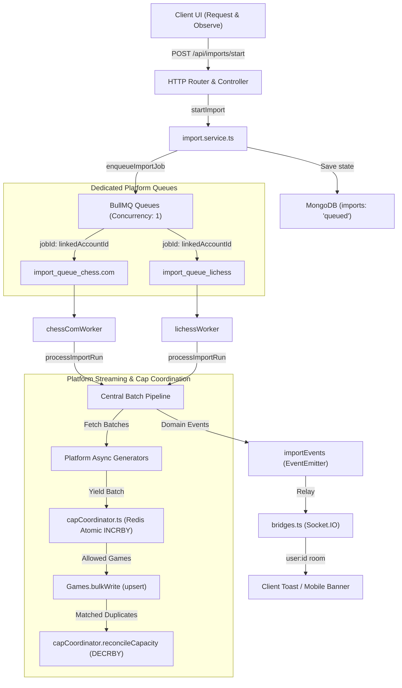
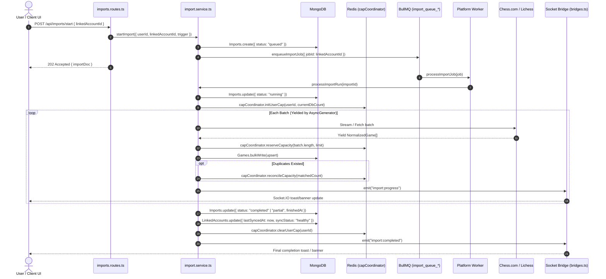

# Imports: Architecture

> **STATUS: ACTIVE (2026-10-24). Design direction & implemented architecture.**
>
> This document captures the architecture agreed in discussion as well as the
> concrete production implementation of the import subsystem.
>
> **If you change something, keep the core decisions in mind.** Each decision
> below is tagged with a level. A change to a **Core** decision should be a
> deliberate rethink: read the "why", consider what else depends on it, and
> update this doc in the same change with the reason. **Leaning** decisions can
> be changed more freely but should still be updated here. **Open** items are
> undecided.
>
> This applies to humans and AI agents alike (see `AGENTS.md`: plan before
> implementing).

## Decision levels

| Tag | Meaning |
| :--- | :--- |
| **Core** | Foundational. Much else depends on it. Change only with a conscious rethink and a doc update. |
| **Leaning** | Current best answer. Open to change if there is a good reason. Update this doc if it changes. |
| **Open** | Not decided yet. Needs a decision before or during the build. |

---

## 1. Why we rebuilt

The first implementation treated an import as an *event*: the client clicked, a
job ran, sockets reported progress, and then it was over. State lived in the
stream of socket events, so a missed event, refresh, or dropped connection left
the UI stuck. Failures were swallowed, completion was tracked as one global
value, and the client orchestrated several server steps by hand.

That cannot support the product vision: **import history**, **automatic
background imports**, and **reliable onboarding**. All three need an import to
be a durable thing with an identity and a history.

## 2. Core principles

1. **Durable state is the source of truth. (Core)**
   Imports live in the database. The queue, the sockets, and the UI are views
   of, or executors for, that state. Nothing holds import state that the
   database does not.
2. **An import is a resource, not an event. (Core)**
   It has an identity, a lifecycle, and a history, independent of whether
   anyone is watching.
3. **Sync belongs to a linked account. (Core)**
   Onboarding, manual import, and (later) scheduled sync are three *triggers*
   for one mechanism. The first import is just the first sync.
4. **The client requests and observes. (Core)**
   It never orchestrates multi-step server work. Closing a tab or losing a
   connection must not leave anything half done.
5. **Sockets are transport only. (Core)**
   The import system emits domain events and knows nothing about sockets. The
   socket layer subscribes and pushes to online users. Offline users lose
   nothing because state is queryable.
6. **One gate for all outbound platform calls. (Core)**
   Every request to Chess.com or Lichess, including verification and preview,
   goes through the same rate-limiting mechanism.

## 3. Layers

```
 Client (request + observe)
        |
 HTTP API  ----  start import / read runs / read account sync state
        |
 Import domain (DB-backed: runs + sync state)  --- emits domain events --->  Socket transport (online users)
        |
 Queue (executor, one lane per platform, shared limiter)
        |
 Platform adapters (Chess.com, Lichess)  -->  shared pipeline (dedupe, cap, upsert, progress)
```

- **Platform adapters (Core).** Each platform implements the same small
  contract: given an account, return the next batch of normalized
  games. Everything else is one shared pipeline: dedupe,
  cap checks, upsert, progress, failure handling. A new platform means a new
  adapter, not a new import system.
- **Domain events (Core).** Run started, progressed, completed, failed. Sockets
  are one subscriber; others (notifications, email) can be added later.

## 4. Data model (conceptual)

Field lists below are **indicative, not a schema**. The shapes and invariants
matter more than the exact names.

### 4.1 Sync state on the linked account (Core)

The long-lived memory of an account:

- **last synced at** (`lastSyncedAt?: Date`): timestamp of when the sync completed (`new Date()`).
- a **cursor** (`cursor?: { lastArchiveUrl?: string | null; lastGamePlayedAt?: number | null }`):
  - **Chess.com**: `lastArchiveUrl` stores the latest monthly archive URL fetched (`.../games/YYYY/MM`), preventing wasteful re-fetching of older months on incremental syncs.
  - **Lichess**: `lastGamePlayedAt` stores the epoch timestamp (ms) of the newest game seen, used as `since` (with a 2-minute safety overlap) for incremental stream fetches.
- a **status** (`syncStatus`: `never_imported` | `healthy` | `needs_attention`)
- later: whether background sync is enabled

### 4.2 Import run (Core)

One document per import attempt, per linked account. History of what happened:

- user, linked account, platform
- **trigger**: `onboarding` | `manual` | `scheduled`
- **status** (see section 5)
- counters: `fetched`, `inserted`, `duplicates`, `skipped`
- error (code + message) when relevant, and a reason when partial
- started at, finished at
- reference to the queue job (for debugging only; never the source of truth)

### 4.3 Invariants

- **At most one active run per linked account. (Core)** Enforced by the
  database (not just application code) so two clicks cannot race. Starting an
  import while one is active returns the existing run.
- **Runs are per linked account. (Core)** Failures and limits are all
  per account. If the UI wants to show "your import" for two accounts, it
  groups runs for display only; there is no run that covers both platforms.
- **Imports are idempotent. (Core)** Re-running is always safe (upsert with the
  unique index on user + platform + platform game id). This is what makes
  retries and incremental syncs completely crash-safe without cursor bookkeeping.
- **Failed imports restart cleanly.** If an import fails midway, it records the failure. The next run re-fetches cleanly up to `lastSyncedAt` or from scratch if `lastSyncedAt` is undefined.

## 5. Run lifecycle

```
queued -> running -> completed
                 \-> partial     (finished, but not everything: e.g. cap reached)
                 \-> failed      (stopped by an error)
queued|running -> cancelled      (if/when cancel is supported)
```

- `completed`, `partial`, `failed`, `cancelled` are **terminal**.
- **Failure is a first-class state (Core).** Failed, partial, rate-limited, and
  retrying each need distinct payloads and distinct UI, not just success versus
  "something went wrong".
- Exact retry and backoff policy: **Open** (section 11).

## 6. User flow

**`needsOnboarding` means "no linked accounts", and only that. (Core)**

1. **No linked accounts -> onboarding.**
   - Step 1: connect (enter usernames, verify).
   - Step 2: preview ("is this you?"), using public profile stats. This step is
     ephemeral client state; nothing durable has happened yet.
   - Step 3: confirm. Confirming is **one backend command** that links the
     accounts and creates the runs, returning run ids. No client-side
     multi-step orchestration, and no half-connected state. **(Core)**
2. **Linked account with no games -> global import required prompt. (Core)**
   - `needsOnboarding` is strictly for accounts (`linkedAccounts.length === 0`).
   - If a user has linked accounts but 0 games (e.g. initial import failed, skipped, closed tab, or pending), we do not render complex empty charts or broken partial pages.
   - The backend bootstrap payload (`getAccountBootstrap`) includes a fast server-computed signal: `hasGames: boolean` (or `gameCount: number`).
   - **Component architecture:** An `<ImportRequiredGate />` wrapper sits directly in the route tree inside `ProtectedAppGate` (wrapping `/dashboard`, `/game-bank`, `/collections`), keeping `AppShell` intact so header, user button, and settings remain accessible.
   - When `hasGames === false`, the gate intercepts the child routes and renders a unified route-contextual prompt instead of individual page fallbacks:
     - Dashboard: *"You haven't imported your games yet. Sync your games to view your stats, ratings, and recent matches."*
     - Game Bank: *"Your Game Bank is empty. Import your games to explore your archive."*
     - Collections: *"No collections can be displayed right now. Import your games to begin organizing them."*
     - Each provides a clear **[Sync Games Now]** action to trigger/resume the import flow.
     - Note: `/settings` remains unblocked so the user can manage linked accounts.
   - Once at least one game exists (`hasGames === true`), `<ImportRequiredGate />` simply renders `<Outlet />`, unlocking standard page views. If anything looks incomplete, users always have the manual sync button in the UI/badge.
3. **Where the user is comes from data, not client memory. (Core)**
   - A refresh or closed tab resumes correctly because import state and game presence are queried from the server.

The progress UI renders from the run state (queried), with socket events as a
live-update layer on top.

## 7. Rate limiting and fairness

Goal: never get our server blocked by Chess.com or Lichess.

- **The limit is on our outbound calls per platform, not per user. (Core)**
  It is effectively per egress IP. So the limiter is shared and global per
  platform.
- **One queue lane per platform, worker concurrency 1. (Leaning)**
  This gives "one request at a time" per platform using the queue itself rather
  than a hand-written manager. The Chess.com and Lichess lanes are independent,
  so one user's two accounts can import in parallel.
- **Shared limiter lives in Redis (Leaning)** so multiple worker processes
  agree.
- **On HTTP 429, pause that platform's lane for a cooldown (Leaning)** instead
  of failing runs. Runs wait; they do not fail.
- **Verification and preview calls go through the same gate. (Core)** They spend
  the same budget.
- **Priority (Leaning).** Onboarding and manual runs outrank scheduled
  background syncs, because a person is waiting.

## 8. Game cap

- **The cap is defined by the account's plan and enforced by the importer.
  (Core)** (`Account.plan.gameBankLimit`; the global `MAX_GAMES_PER_USER`
  constant should stop being the source of truth.)
- **Check before the run starts and during the run. (Core)** A run can overshoot
  mid-import, so remaining capacity is re-checked as it goes.
- **Reaching the cap ends the run as `partial` with a reason** such as "cap
  reached". (Leaning)
- **The cap is per user, combined across all platforms. (Core)** `gameBankLimit`
  counts the total number of games in the games collection for that userId,
  regardless of platform. If Chess.com has 5,000 games and the limit is 5,000,
  only Chess.com games get imported. Adding per-platform sub-limits is
  unnecessary complexity and will not be implemented.
- **Imports go newest-first. (Core)** A capped user keeps their most recent
  games. Users remember and care about recent games more than old ones. UI
  sorting (newest/oldest) is a separate query-filter concern and does not affect
  import order.
- **The onboarding preview must not promise more than the importer will
  deliver.** If the preview says "~12,000 games" and the cap is lower, say so.

## 9. Events and the socket layer

- The import domain emits events keyed by **run id** (Core).
- The socket layer subscribes and relays to the user's room (`user:<id>`),
  stripping internal fields (Core).
- Clients match progress to the run they care about via run id. There is no
  single global "import complete" value. (Core)
- Socket delivery is best-effort; correctness never depends on it. (Core)
- **Notification UX. (Leaning)** Socket events surface as:
  - **Desktop / tablet:** a small toast in the bottom-right corner.
  - **Mobile:** a slim banner at the top of the screen.
  - Example message: *"Chess.com import complete — 4,821 games added."*
  - These are informational only. The user does not need to act on them.

## 10. Failure cases the design must handle

- Queueing a job fails after the run was created (needs a reconciler: runs left
  `queued` with no job get picked up or failed)
- Linking succeeds for one account and fails for another
- Two accounts finish at different times (flow is done only when every run is
  terminal)
- Platform returns 429 or is down
- Worker crashes mid-run (resume from cursor)
- Duplicate start request (return the existing active run)
- Cap reached mid-run
- Linked account removed while a run is active
- Platform username renamed or account closed/deleted
- User deleted while a run is active (data purge must cancel runs)

## 11. Open questions

1. Retry/backoff policy for failed runs; when does an account get flagged
   "needs attention" (e.g. reconnect needed) instead of retrying forever?
2. Scheduled sync: frequency per plan, jitter, pause/resume by the user.

**Decided:**
- ~~What exactly does the game cap count, and per user or per account?~~
  → Per user, combined across all platforms.
- ~~Newest-first with the cap: is "keep the most recent games" the intended behavior?~~
  → Yes. Confirmed. Newest-first always.
- ~~Is run cancellation required for v1?~~
  → No. Not in v1. Adds unnecessary complexity.
- ~~Do we show import history in the UI at launch, or only store it?~~
  → Yes, import history is shown in the UI at launch.
- ~~Resume cursor vs re-run from scratch?~~
  → Dropped resume cursor entirely. Idempotent upserts mean failed runs restart cleanly without tracking granular cursor chunks.
- ~~Lichess API Token?~~
  → Dropped. Not needed for v1.

## 12. Lessons from the first implementation (do not carry over)

Found in an audit of the first implementation; each should be avoided by design:

- Queue-start failures were swallowed (`console.error` only), so the UI waited
  forever for a completion event that would never arrive.
- Completion was a single global value, so the first of two finishing imports
  ended the whole flow.
- The stats preview silently skipped accounts it could not fetch and still
  returned success, allowing an empty "verify" step with Continue enabled.
- Debounced username verification had no cancellation; a late response for an
  older username could mark a newer one valid.
- Verification happened several times per username (typing, proceed, preview,
  connect), spending rate-limit budget.
- Connect-with-nothing-linked returned HTTP 400 while the client expected a
  `success: false` body, so per-account messages were likely lost.
- The preview's game count and the importer's cap disagreed.
- Socket client pointed at a URL path, which Socket.IO treats as a namespace.
  Use the origin.

## 13. What carries over

The platform-specific fetch/stream/normalize logic and the idempotent upsert
(unique index on user + platform + platform game id) are sound. The rebuild
replaces what is *around* them: who starts imports, where state lives, how the
client learns about it.

---

## 14. Implementation Architecture (Implemented 2026-10-24)

This section documents the exact implemented modules, execution pipelines, and data flows in production.

### 14.1 Execution Flow





### 14.2 Production Modules Breakdown

1. **Atomic Cap Coordinator (`Backend/src/Utils/capCoordinator.ts`)**:
   - Backed by dedicated app-level Redis connection (`redis.ts`).
   - Uses Redis key `import:cap:{userId}` with a 1-hour safety TTL.
   - `reserveCapacity(userId, batchSize, planLimit)`: Atomically reserves batch size using `INCRBY`. If limit is exceeded, calculates overage, rolls back via `DECRBY`, truncates allowed batch, and marks `isCapped: true`.
   - `reconcileCapacity(userId, matchedCount)`: Refunds duplicate games (`matchedCount`) back to available capacity atomically.
   - `clearUserCap(userId)`: Deletes the counter once all active runs for the user conclude.

2. **Core Service & Async Generators (`Backend/src/Services/import.service.ts`)**:
   - `fetchChessComBatches(username, userId, lastArchiveUrl)`: Fetches archive URLs, filters to months `>= lastArchiveUrl`, and iterates monthly archives in reverse chronological order.
   - `fetchLichessBatches(username, userId, max, lastGamePlayedAt)`: Streams NDJSON using `{ max, since }` params (with a 2-minute safety overlap buffer), filters supported chess variants, and yields batches of 100 games.
   - `processBatch`: Orchestrates reservation, `Games.bulkWrite(ops, { ordered: false })`, duplicate reconciliation, and live progress event emission.
   - `finalizeRun`: Marks run as `"completed"` or `"partial"` (if cap ceiling reached), updates `linkedAccount.lastSyncedAt = new Date()`, updates platform cursor (`cursor.lastArchiveUrl` or `cursor.lastGamePlayedAt`), updates `syncStatus = "healthy"`, and emits `import:completed`.
   - `handleRunFailure`: Marks run as `"failed"` with `{ error: { code, message } }`, sets `syncStatus = "needs_attention"`, and emits `import:failed`.

3. **Dedicated Queues & Concurrency (`Backend/src/Jobs/import.queue.ts` & `import.worker.ts`)**:
   - `import_queue_chess.com` and `import_queue_lichess` running with `concurrency: 1`.
   - Strict rate-limit safety: Outbound requests to Chess.com or Lichess never overlap across any users. Cross-platform sync runs in parallel.
   - BullMQ deduplication: `jobId: linkedAccountId` guarantees BullMQ ignores duplicate active job submissions.

4. **HTTP Endpoints & Validation (`Backend/src/Routers/imports.routes.ts`)**:
   - `POST /api/imports/start`: Validated via `startImportBody` Zod schema. Accepts optional `trigger` (derives `"onboarding"` if `!lastSyncedAt` else `"manual"`).
   - `GET /api/imports/history`: Returns user import history sorted by `createdAt: -1`.

5. **Socket Domain Bridge (`Backend/src/Sockets/bridges.ts`)**:
   - Listens to internal `importEvents` (`import:progress`, `import:completed`, `import:failed`) and pushes clean payloads to `user:${userId}` room.

6. **Frontend Routing & UI (`Frontend/src/`)**:
   - `<ImportRequiredGate />` in `App.tsx`: Intercepts `/dashboard`, `/game-bank`, and `/collections` when `hasGames === false` with contextual empty prompts and a **[Sync Games Now]** action. Leaves `/settings` unblocked.
   - `<ImportNotificationToast />` in `AppShell.tsx`: Displays floating bottom-right toasts on desktop/tablet and a slim top banner on mobile for real-time completion/failure feedback.

---

## 15. Change Log

- **2026-10-24**: Modeled explicit sync cursors on `LinkedAccount` (`cursor.lastArchiveUrl` for Chess.com, `cursor.lastGamePlayedAt` for Lichess) to avoid re-fetching historical batches on subsequent runs while keeping `lastSyncedAt` as the completion timestamp. Removed duplicate Mongoose index on `linkedAccountId`.
- **2026-10-24**: Implemented and verified full production import subsystem. Added Section 14 (Implementation Architecture). Preserved all foundational architectural principles and decision rationales.
- **2026-10-23**: Closed open decisions: combined cap, newest-first, no cancellation v1, import history UI at launch. Documented notification UX (toast/banner) in Section 9.
- **2026-10-23**: Added global import required prompt pattern and `hasGames` bootstrap signal to Section 6.
- **2026-10-23**: Initial draft from architecture discussion.
