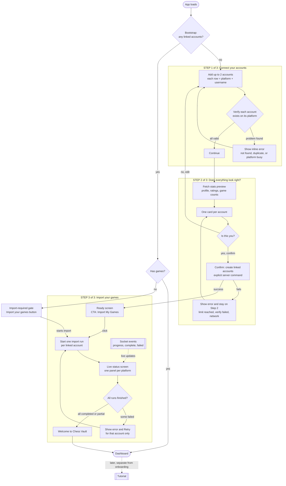

# Onboarding: Flow

> **STATUS: DRAFT (2026-10-24).** Design direction for the rebuilt onboarding
> flow, to be built on top of the import system in `Docs/IMPORTS.md`. Not set in
> stone. Decisions are tagged **Core** (change only with a deliberate rethink and
> a doc update), **Leaning** (current best answer), or **Open** (undecided).

## The three steps

Onboarding is exactly three steps (**Core**): connect accounts, confirm them,
import. The user always knows which step they are on ("Step N of 3").

## Step by step

### Step 1: Connect your accounts

- The user adds account rows. Each row is a **platform selector plus a
  username**. (**Core**)
- **Maximum 2 accounts during onboarding**, read from the plan
  (`plan.linkedAccountLimit`), not hard-coded in the UI. (**Core**) At the limit,
  "Add another account" is disabled.
- Two accounts on the same platform are allowed, as long as they are different
  usernames. The same username on the same platform is rejected
  (case-insensitive; this matches the unique index on user + platform +
  normalized username). The same username on two different platforms is fine.
  (**Core**)
- The old UI used a "both / Chess.com only / Lichess only" switch, which cannot
  express two Chess.com accounts. A list of rows replaces it.
- Each account is verified against its platform. Verify on blur or on Continue
  rather than on every keystroke, to save platform rate-limit budget
  (**Leaning**; all outbound platform calls share one budget, see IMPORTS.md).
- Nothing is saved to the database in this step.

### Step 2: "Does everything look right?"

- Shows one card per account: profile, ratings, game counts. The point is for
  the user to recognize themselves ("yes, that's me"). (**Core**)
- **Confirm is the moment linked accounts are created**, as one explicit server
  command. (**Core**) Before this, nothing durable exists, so backing out is free.
- If confirm fails (limit reached, verification failed, network), the error shows
  here and the user stays on Step 2.
- "No, edit" goes back to Step 1 with the entered accounts preserved.

### Step 3: Import your games

Two screens:

1. **Ready screen.** A clear CTA: "Import My Games". Importing starts only when
   the user clicks it, never automatically. (**Core**)
2. **Live status screen.** Clicking starts one import run per linked account and
   switches to a dedicated status screen driven by socket events. (**Core**)
   **Transparency is a core requirement**: the user should know exactly what is
   happening.

Per-platform panel (**Core**):

| Shown | Meaning |
| :--- | :--- |
| State | waiting in line, importing, completed, stopped at your limit (partial), failed |
| Fetched | games found on the platform so far |
| Added | games stored in the vault |
| Already in vault | duplicates that were ignored |
| Skipped | games not imported (unsupported variants or rules) |
| Vault usage | games in the vault versus the plan limit (for example 1,240 / 5,000) |

Outcomes:

- **All runs completed or partial** -> "Welcome to Chess Vault" -> Dashboard.
  A `partial` run is not an error. The panel explains that the vault limit was
  reached.
- **A run failed** -> show the error with a Retry for that account only; the
  other account is unaffected.

## Leaving or refreshing mid-flow (Leaning)

`needsOnboarding` means "no linked accounts", and only that. So after confirming
in Step 2 the user is no longer "in onboarding" as far as the app can tell:

- Leaving before Step 2's confirm: nothing was saved; they restart at Step 1.
- Leaving after confirm but before importing: they land on the dashboard behind
  the import-required gate, which offers the same import button.
- Leaving during an import: the run continues on the server. A toast announces
  completion or failure, and the status can be re-read from the server.
- The import-required gate should show live progress when a run is already
  active, instead of offering to start another.

## Backend support needed for the transparency requirement

Found by reading the current import service. These are gaps, not bugs:

1. **`skipped` is never counted.** Unsupported variants and rules are silently
   dropped inside the fetchers, so the counter stays at 0. The fetchers need to
   report how many games they dropped.
2. **Progress events carry no vault usage.** The payload has only the counters.
   Add the user's current stored total and plan limit (the cap coordinator
   already tracks the running total).
3. **There is no expected total**, so there is no real percentage. The preview's
   game counts can serve as an estimate, but they overstate when games are
   unsupported or capped. Treat any progress bar as approximate. (**Open**)
4. **The status screen must hydrate from the server**, using the existing import
   history endpoint, so a refresh mid-import still shows the correct state.
   Sockets only provide live updates on top.
5. Chess.com progress updates once per archive month, so progress can look
   chunky on that platform. That is acceptable.

## After onboarding

- A short **tutorial** on using the app is wanted, but **after** the
  import/onboarding flow, as its own feature. It is not part of these three
  steps. (**Core**)

## Open questions

1. Does the progress bar use the preview's estimate, or just show counts?
2. Should "Welcome to Chess Vault" auto-navigate after a few seconds, or wait for
   the user to click through?
3. Where does the tutorial start (first dashboard visit, or a "Take the tour"
   prompt)?

## Change log

- 2026-10-24: Initial draft from the onboarding flow discussion.